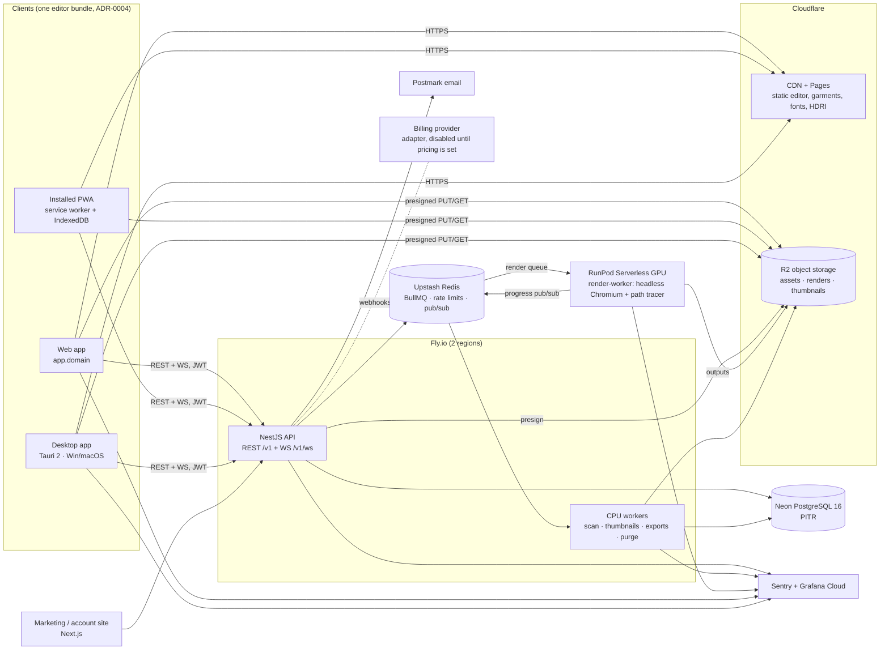
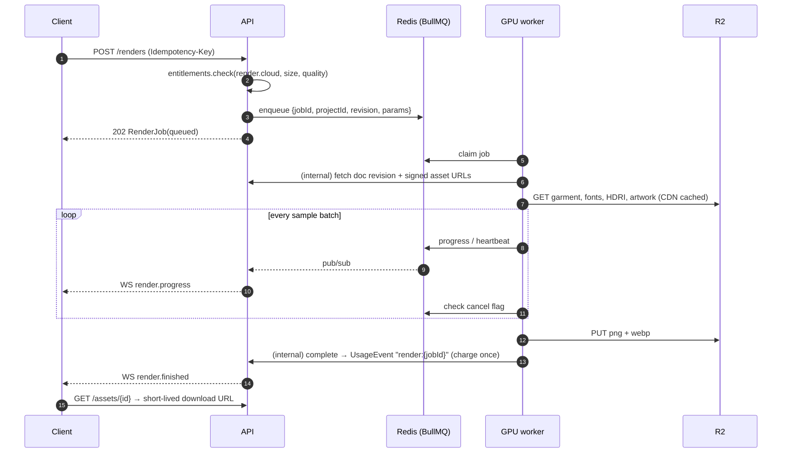
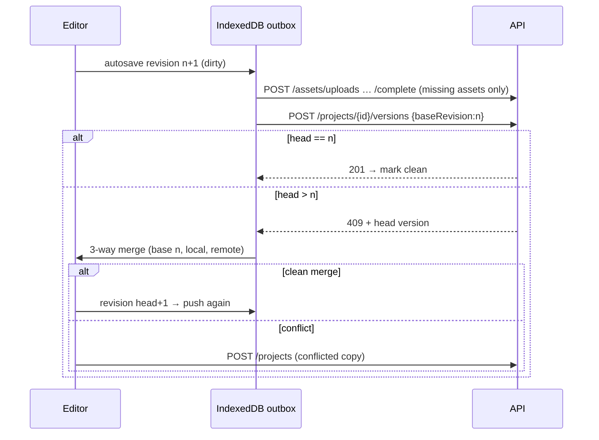
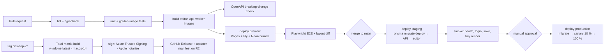

# Infrastructure (Stage 2 draft)

Decisions: ADR-0013 (rendering), ADR-0014 (storage), ADR-0016 (hosting/CI), ADR-0017 (observability).
Domains are placeholders until the product name is final (ADR-0002).

## 1. System context

## 2. Render job sequence

## 3. Sync sequence (ADR-0009)

## 4. Environments

| | dev | preview (per PR) | staging | production |
|---|---|---|---|---|
| Editor/site | Vite dev server | Pages preview URL | Pages `staging` | Pages `main` |
| API | local Node | ephemeral Fly app | Fly `gs-api-stg` (1 region) | Fly `gs-api` (2 regions, min 2 machines) |
| Postgres | Docker postgres:16 | Neon branch | Neon `staging` | Neon `prod` (dedicated, PITR 7 d) |
| Redis | Docker redis:7 | Upstash free DB | Upstash fixed | Upstash fixed, TLS |
| Storage (private + public garment bucket, ADR-0019) | SeaweedFS (`infra/dev`) | R2 bucket `gs-preview` (TTL 7 d) | R2 `gs-stg` | R2 `gs-prod` (versioning on) |
| GPU render | local GPU or mock worker | mock worker | RunPod endpoint (min 0) | RunPod endpoint (min 1 in business hours) |
| Email | Mailpit | Mailpit | Postmark sandbox | Postmark |
| Billing | ManualProvider | ManualProvider | provider sandbox (when enabled) | provider live (when enabled) |

## 5. CI/CD pipeline

## 6. Backups and recovery

| Data | Mechanism | RPO | RTO |
|---|---|---|---|
| Postgres | Neon PITR (7 d) + nightly logical dump to a separate R2 bucket (30 d, encrypted) | ≤ 5 min | ≤ 1 h |
| Object storage | R2 object versioning (30 d) + weekly cross-account replica of `u/` prefix | 24 h (replica) | ≤ 4 h |
| Redis | Not a source of truth; queues rebuilt from `render_jobs` rows in `queued/running` | – | minutes |
| Client data | IndexedDB + desktop journal; projects can be exported as `.gsproj` | – | – |

A restore drill (staging, from the production dump) runs quarterly, plus once before launch (Stage 12).

## 7. Capacity assumptions (to be validated with load tests in Stage 12)

- API: one shared-cpu-2x machine handles about 300 req/s of mixed CRUD (to benchmark; no claims until measured).
- Document size ≤ 2 MB; typical 20–80 KB. Version rows are pruned to keep every revision for 30 days and then daily keyframes.
- Render cost driver: GPU seconds ≈ f(pixels × samples). Budget per job to be measured on L4 in Stage 7.

## 8. Rough monthly cost at launch (excluding GPU usage)

Cloudflare Pages/R2 ~$5–20 · Fly API (2× shared-2x + workers) ~$40–80 · Neon Launch ~$19–69 · Upstash ~$10–30 · Sentry Team ~$26 · Grafana Cloud free–$50 · Postmark ~$15 → **≈ $120–290 / month**, plus GPU at per-second rates. These are list-price estimates to confirm before Stage 8.

## Render workers (Stage 7, ADR-0020)
- **Process:** `node dist/render-worker.js` from `apps/api`, plus the built editor (`RENDER_PAGE_DIR`) and Playwright's Chromium in the image.
- **Capacity:** one job per GPU (BullMQ concurrency 1).
- **GPU backend:** set with `RENDER_CHROMIUM_ARGS`. On Linux NVIDIA nodes, validate `--use-angle=vulkan` (or EGL) on staging, and confirm the GPU line the worker logs at start isn't SwiftShader.
- **Shader cache:** keep `RENDER_PROFILE_DIR` on a persistent volume so the compiled-shader cache survives restarts; the first compile can take about a minute.
- **Readiness:** the worker renders a 1-sample warm-up frame before taking jobs.
